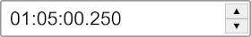

### React Duration Input


A simple, customizable duration input field for React with Typescript support.



## Installation

```bash
npm install react-duration
```

## Usage

```tsx
import { useState } from 'react';
import DurationInput from 'react-duration';

function App() {
  const [duration, setDuration] = useState(125.4); // Duration in seconds

  return (
    <DurationInput
      value={duration}
      onChange={setDuration}
    />
  );
}
```

## Props

| Prop | Type | Description |
|------|------|-------------|
| `value` | `number` | Initial duration value in seconds |
| `onChange` | `(seconds: number) => void` | Callback fired when duration changes |
| `buttonIncrement` | `number` | Seconds to increment/decrement when buttons are pressed (default: `0.1`) |
| `minValue` | `number` | Minimum allowed value in seconds |
| `maxValue` | `number` | Maximum allowed value in seconds |
| `noButtons` | `boolean` | Hide the increment/decrement buttons |
| `style` | `CSSProperties` | Custom styles for the wrapper element |
| `className` | `string` | Custom class name for the wrapper element |
| `name` | `string` | Name attribute for the input element |

## Styling

The component exposes the following CSS classes for customization:

| Class | Element |
|-------|---------|
| `duration-input-wrapper` | Outer wrapper |
| `duration-input` | Text input field |
| `duration-input-button-wrapper` | Button container |
| `duration-input-button` | Both buttons |
| `duration-input-up-button` | Increment button |
| `duration-input-down-button` | Decrement button |

## License

MIT
